# ADNI Alzheimer's Disease Classification with ConvNeXt

**Author: Christopher Marchand**  
**Student ID: 48900353**

## Feasibility Review

### User Need and Scope
The intended user this project is aimed towards is a researcher evaluating a machine learning model that could assist human reviewers in diagnosing Alzheimer's disease from MRI images. The project scope is limited to training and evaluating the models on the course-provided 2D ADNI MRI images, it will not aggregate multiple brain slices from the same patient to produce a prediction.

### Acceptance Criteria
1. Every included ADNI image has a valid mapping to a patient, and the training, validation, and testing set has no patient leakage.
2. ConvNeXt achieves a test accuracy of at least `80%`.
3. The ConvNeXt model achieves a higher test accuracy than the baseline ResNet-18 model.
4. Training fits within the provided NVIDIA A100 GPUs available VRAM.
5. The model must automatically accept at least 80% of test images with a prediction confidence of 90% or higher, referring the remaining images for human review.

### Model Choice and Course Concepts
The selected models are ConvNeXt, which serves as the advanced model, and ResNet-18, which serves as the smaller baseline. Both models will be initialised with random weights and trained from scratch. The ConvNeXt design will closely follow the architecture presented in *A ConvNet for the 2020s (Liu et al., 2022) [1]*, using stage depths of `(3, 3, 9, 3)` and channel dimensions of `(96, 192, 384, 768)`. The ResNet-18 design will similarly follow the architecture described in *Deep Residual Learning for Image Recognition (He et al., 2015)*, using `(2, 2, 2, 2)` residual blocks and channel dimensions of `(64, 128, 256, 512)`. ResNet-18 was chosen as the baseline because ConvNeXt was developed by progressively modernising the ResNet architecture, making ResNet a suitable reference point for evaluating the benefits of ConvNeXt's design changes.

There will be 2 main changes from the original architectures. Both model's input layers will be modified to accept a single channel instead of the original three RGB channels, and their classification layers be will reduced to only two outputs for AD and NC classification.

### Preliminary Feasibility Evidence
Preliminary data audits were conducted in Jupyter notebooks to assess the feasibility of preparing the ADNI dataset and running the proposed models on it. It was identified that the dataset contained `30520` grayscale JPEG images, all measuring `256 x 240` pixels, and these images were linked to `1526` scans from `680` unique patients. This consistent image format already provided an effective dataset prior to any preprocessing. However, the original training and test sets shared `216` patients across them, revealing there was patient leakage across the sets.

To address this implementing stratified split by patient was investigated, assigning each patient to exactly one split. This resulted in `21360` training, `6100` validation, and `3060` test images, approximately matching the intended 70/20/10 proportions. The images were also broadly well balanced between classes, with `15660` NC images, and `14860` AD images.

Preliminary runs on an NVIDIA RTX 5070 Ti successfully began training ResNet-18 with a maximum tested batch size of `512` and ConvNeXt with a maximum tested batch size of `128`. Both configurations fit within the GPU's 16 GB of VRAM, indicating that they will fit within the larger VRAM capacity of the available NVIDIA A100 GPUs, especially given that smaller batch sizes will be used. These findings provide preliminary evidence that the proposed model configuration is computationally feasible on the available hardware.

### Risks, Budget, Next Experiment, and Fallback
The main risks this project currently has are:
  - The long model training times.
  - The A100 GPU's available VRAM.

Long training runs may prevent the models from completing enough epochs to converge before the assignment deadline. Memory limits may also restrict the model size, if the models that fit have insufficient capacity to learn the patterns in the training set, they could underfit.

The next experiment will test difference ConvNeXt and ResNet model adjusting the number of stages and channel dimensions. This will establish which combinations fit in memory. If the preferred configurations exceed the memory limit, the fallback is to use smaller ConvNeXt and ResNet models with fewer parameters and reduce the batch size until training fits with the A100's VRAM.


## 1. Problem and Working Principles
This project implements a 2D convolutional network to classify ADNI brain MRI slices as Alzheimer's disease `AD` or cognitively normal `NC`. ConvNeXt is the main model, and ResNet-18 will provide a baseline. The engineering objective is to compare recognition performance, computational cost, and the reliability of unconfident predictions on ambiguous images that may need to be flagged for human review.

The data pipeline collects JPEG slices from the original dataset folders, groups them using the patient ID extracted from each filename, and assigns groups to approximately `70%` training, `20%` validation, and `10%` testing. Images are resized, converted to tensors, and standardised. Random augmentation is applied only to the training set to prevent overfitting. Each model learns spatial features through convolutional stages and residual connections, pools the final features, and outputs two classification logits. The epoch with the highest validation accuracy is saved for test evaluation. All reported scores describe individual slices, not aggregated patient diagnoses.

## 2. Model Architectures
### 2.1 ConvNeXt Implementation
ConvNeXt (Liu et al., 2022) improved on the ResNet architecture by modernising ResNet-50 using design ideas from Vision Transformers while maintaining the simple convolutional structure of a traditional CNN.

Each block uses a `7 x 7` convolution to detect pattern in each feature channel separately. After normalisation, two linear layers mix information between channels, expanding their number by 4 and then reducing it back. GELU helps the model learn complex patterns. The result is scaled and added to the original input through a skip connection. During training, this added branch is sometimes dropped to help reduce overfitting.

| Component | Implementation | Output per image |
| --- | --- | --- |
| Input | Single channel image | `1 × 224 × 224` |
| Stem | `4 × 4` convolution, stride = 4 | `96 × 56 × 56` |
| Stage 1 | 3 blocks | `96 × 56 × 56` |
| Downsample 1 | `2 × 2` convolution = stride 2 | `192 × 28 × 28` |
| Stage 2 | 3 blocks | `192 × 28 × 28` |
| Downsample 2 | `2 × 2` convolution = stride 2 | `384 × 14 × 14` |
| Stage 3 | 9 blocks | `384 × 14 × 14` |
| Downsample 3 | `2 × 2` convolution = stride 2 | `768 × 7 × 7` |
| Stage 4 | 3 blocks | `768 × 7 × 7` |
| Pool and head | LayerNorm, linear `768 → 2` | 2 logits |

This design follows (Liu et al., 2022) configuration of `(3, 3, 9, 3)` blocks with `(96, 192, 384, 768)` channel dimensions giving approximately `27.8` million parameters. This project however changes the original design by reducing the stem down to 1 input channel and reducing the classification layer to 2 classes.

### 2.2 ResNet-18 Implementation
ResNet-18 will provide a suitable baseline comparison for the ConvNeXt network since it was the predecessor ConvNeXt was based off. Each `ResNetBlock` contains a `3 x 3` convolution, BatchNorm and ReLU followed by another `3 x 3` convolution and BatchNorm. The output is added to a skip connection and passed through ReLU. This allows the block to learn a residual correction while preserving a direct path for information and gradients.

| Component | Implementation | Output per image |
| --- | --- | --- |
| Input | Single channel image | `1 × 224 × 224` |
| Stem convolution | `7 × 7`, stride = 2 | `64 × 112 × 112` |
| Max pooling | `3 × 3`, stride = 2, padding = 1 | `64 × 56 × 56` |
| Stage 1 | 2 residual blocks, 64 channels | `64 × 56 × 56` |
| Stage 2 | 2 blocks | `128 × 28 × 28` |
| Stage 3 | 2 blocks | `256 × 14 × 14` |
| Stage 4 | 2 blocks | `512 × 7 × 7` |
| Pool and head | Adaptive average pool to `1 × 1`, linear `512 → 2` | 2 logits |

This design differs from the original (He et al., 2015) ResNet architecture by using a single input channel stem, adaptive global pooling and a 2 output classification layer. This gave a configuration of `(2, 2, 2, 2)` blocks with `(64, 128, 256, 512)` channel dimensions providing approximately `11.2` million parameters.

## 3. Dataset Preprocessing
### 3.1 Patient Splitting
The original provided ADNI dataset had patient leakage across the training and test sets. To fix this the original dataset was pooled together and resplit by patient ID provided by the images file names.

The filenames for example, `388206_78.jpeg` provided the patient ID `388206` and the slice index `78`. To avoid patient leakage, all slices were placed in the same split with their associated patient. To accomplish this, the `1526` scans were split into `70%` training, `20%` validation, and `10%` testing, then the images were assigned to the split of their corresponding patient ID.

This resulted the following splits below:

| Dataset Split | Total Images | Percentage | Subjects | NC Images | AD Images |
| ------------- | ------------ | ---------- | -------- | --------- | --------- |
| Train         | 21,360       | 69.99%     | 1,068    | 10,960    | 10,400    |
| Validation    | 6,100        | 19.99%     | 305      | 3,120     | 2,980     |
| Test          | 3,060        | 10.03%     | 153      | 1,580     | 1,480     |
| Total         | 30,520       | 100%       | 1,526    | 15,660    | 14,860    |

The dataset is approximately balanced with `NC` and `AD` nearly having equal class proportions.

### 3.2 Preprocessing Images
| Step                                                           | Reason                                                                                                              |
| -------------------------------------------------------------- | ------------------------------------------------------------------------------------------------------------------- |
| Resize to `224 x 224`                                          | All images in dataset are currently `256 x 240`. The standard ConvNeXt and ResNet designs used `224 x 224` images.  |
| Scale Pixel Values to `[0, 1]`                                 | Current pixel values are [0, 255], helps model training by avoiding large activations and gradients.                |
| Standardising using mean `0.1160`, standard deviation `0.2230` | Makes training set approximately mean `0` and standard deviation `1`.                                               |

All images are normalised using mean `0.1160` and standard deviation `0.2230` by: `x_normalised = (x - 0.1160) / 0.2230`. This mean and standard deviation was calculated using the training set and applied to training, validation, and test images. 

### 3.3 Dataset Augmentation
Both models suffered from overfitting to the training set quickly reaching `100%` training accuracy, to fix this a significant amount of data augmentation was needed to prevent the models from memorising the training images. The following random augmentation are applied to training images and reapplied each epoch. Validation and testing images used only the deterministic preprocessing described in section `3.2`.

| Augmentation | Parameters | Intended Effect |
| --- | --- | --- |
| Resize | `256 × 256` | Standardises the images before random cropping. |
| Random resized crop | Output `224 × 224`, area fraction `0.9–1.0`, aspect ratio `0.9–1.1` | Varies framing and scale, however can potentially remove anatomy |
| Horizontal flip | Probability `0.5` | Encourages robustness to left and right orientation changes. |
| Random affine | Rotation `±15°`, horizontal/vertical translation up to `10%`, scale `0.9–1.0` | Varies the position of the brain in the image, however can potentially remove anatomy. |
| Brightness/contrast jitter | Brightness `±0.1`, contrast `±0.15`, | Reduces dependence on intensity appearance. |
| Gaussian blur | Kernel `3 × 3`; sigma `0.1–1.0` | Varies sharpness of images, helps with potential differences in scan quality. |

Augmentation expands the appearances observed during learning without adding more patients. This helped the model generalise improving validation accuracy.

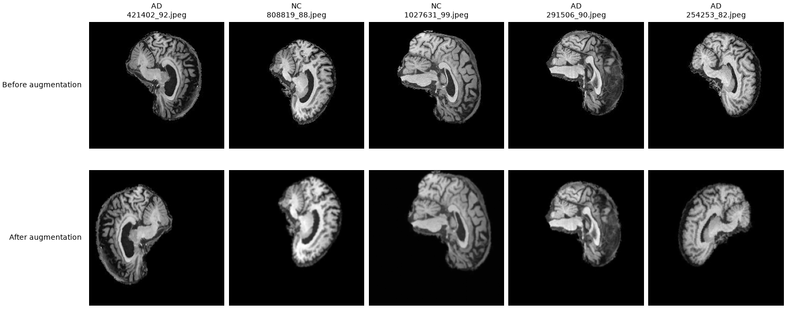
*Plot of training images before and after data augmentations applied.*

## 4. Hyperparameters and Training Methodology


### 4.1 Configuration

| Parameter | ResNet-18 | ConvNeXt |
| --- | --- | --- |
| Initialization | Random weights | Random weights |
| Epochs | `200` | `200` |
| Batch size | `64` | `64` |
| Optimizer | AdamW | AdamW |
| Initial learning rate | `1e-3` | `1e-3` |
| Weight decay | `1e-4` | `0.05` |
| Drop Path | N/A | `0.1` |
| Loss | `CrossEntropyLoss(label_smoothing=0.05)` | `CrossEntropyLoss(label_smoothing=0.05)` |
| Learning rate schedule | `5` epoch linear warmup, then cosine decay toward `1e-6` | `5` epoch linear warmup, then cosine decay toward `1e-6` |
| Checkpoint selection | Highest validation accuracy | Highest validation accuracy |
| Random seed | `42` | `42` |
| DataLoader workers | `4` | `4` |

Validation is run at the end of every epoch where the highest validation accuracy is the model saved. This was to ensure the highest accuracy model was saved even if the models performance degraded afterwards due to overfitting. `200` epochs were used to allow training time for the model to properly converge. A small batch size of `64` was chosen to lower memory usage and use stochastic noise during gradient calculations to potentially help the model escape poor local minima.

### 4.2 Regularisation
- ConvNeXt uses `0.1` drop path for stochastic depth regularisation.
- AdamW weight decay shrinks both models weights towards zero.
- Cross Entropy Loss Label smoothing to reduce over confidence.

### 4.3 Learning Rate Schedule
A combination of a linear warmup and cosine annealing was used to change learning rate during training. For the first `5` epochs the learning rate linearly increases up to the initial learning rate of `1e-3`. Then over the next `195` epochs, cosine annealing is used to progressively reduce the learning rate to `1e-6`. This helps the model achieve smooth convergence in late epoch learning.


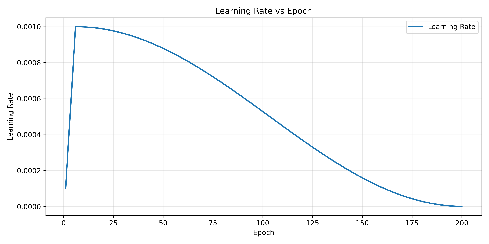
*Plot of learning rate for each epoch.*

## 5. ResNet-18 Model Results

For these results, both models were trained using a NVIDIA RTX 5070 Ti. The test metrics were evaluated using the `10%` testing split.

### 5.1 Training History
The model was trained for `200` epochs which took approximately `37` minutes and `11.24` seconds per epoch. The training loss and accuracy history plots are shown below.

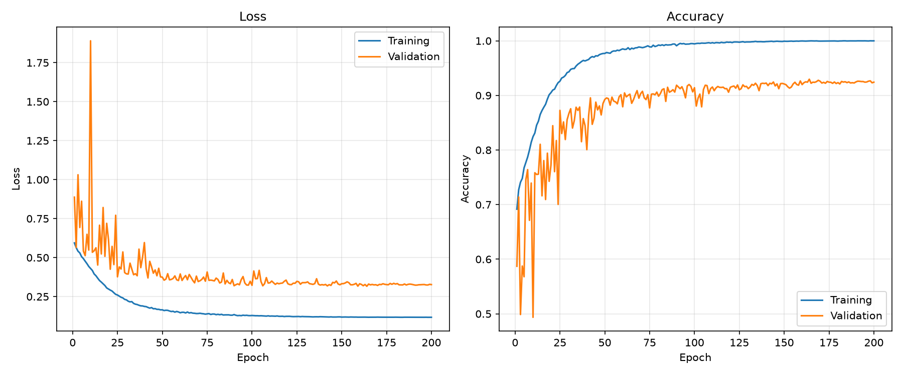
*Training history for ResNet-18 model over 200 epochs.*

The model saved was from epoch `167` which achieved the highest validation accuracy of `91.51%` indicating the model is capable of generalising to unseen data. ResNet-18 demonstrated strong early learning performance quickly increasing to over `90%` training accuracy in less than `25` epochs. training accuracy. Validation accuracy improves significantly, reaching approximately `92%` towards the end of training, indicating strong generalisation to unseen data. During the early epochs, validation accuracy displays considerable fluctuations, with validation loss occasionally exceeding `1.0`, before becoming more stable as training continues. Despite this, training accuracy continues to increase towards `100%`, indicating overfitting without achieving further improvements on the validation set.


### 5.2 Test Results
The final model was evaluated on the hold out test set. The confusion matrix and test metrics below shows the model's performance on this unseen data.


*Confusion matrix for ResNet-18 model.*

| Metric | ResNet-18 |
| --- | --- |
| Accuracy | **91.24%** 
| Macro F1 | **91.24%** |
| AD Precision | **88.26%** |
| AD Recall | **94.46%** |
| NC Precision | **94.44%** |
| NC Recall | **88.23%** |

*Test evaluation results for ResNet-18 model.*

The model achieved strong performance on the test set, with an accuracy of `91.24%`, and Macro F1-score of `91.24%`. Importantly, the model achieved an AD recall of `94.46%` indicating that it successfully identified the majority of Alzheimer's cases. The model also achieved an AD precision of `88.26%` meaning majority of images predicted as Alzheimer's were correctly classified.

## 6. ConvNeXt Model Results
### 6.1 Training History
The model was trained for `200` epochs which took approximately `88` minutes and `26.46` seconds per epoch. The training loss and accuracy history plots are shown below.

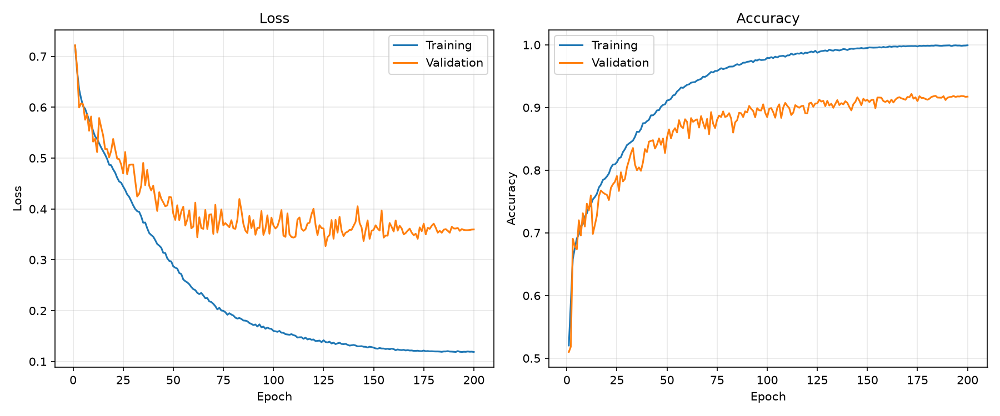
*Training history for ConvNeXt model over 200 epochs.*

The model saved was from epoch `172` which achieved the highest validation accuracy of `92.16%`. Compared to ResNet-18, ConvNeXt demonstrates smoother validation performance following closely to training accuracy during earlier epochs. However, validation accuracy begins to plateau around epoch `120` where training loss continues to decrease and training accuracy approaches `100%`, creating a widening generalisation gap between training and validation performance. This again indicates the model overfitting later in training.

### 6.2 Test Results
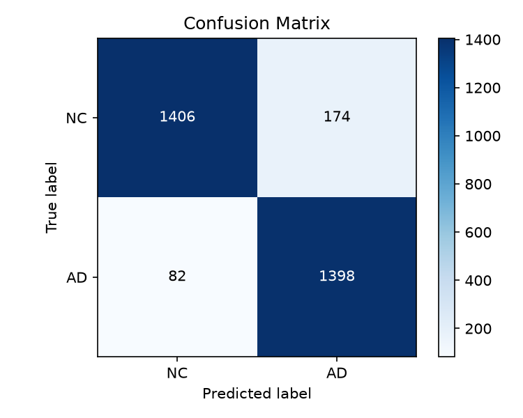
*Confusion matrix for ConvNeXt model.*

| Metric | ConvNeXt |
| --- | --- |
| Accuracy | **91.63%** 
| Macro F1-score | **91.63%** |
| AD Precision | **88.93%** |
| AD Recall | **94.46%** |
| NC Precision | **94.49%** |
| NC Recall | **88.99%** |

*Test evaluation results for ConvNeXt model.*

ConvNeXt achieved stronger performance on the test set compared to ResNet-18, with an accuracy of `91.63%` and macro F1-score of `91.63%`. The model achieved a higher AD precision of `88.93%` but had an equal AD recall of `94.46%` compared to ResNet-18.

ConvNeXt produced `12` fewer false positives to ResNet-18, demonstrating slightly better specificity while maintaining the same sensitivity.

## 7. Analysis of Results
### 7.1 Why Sensitivity Matters
High sensitivity is particularly important for this Alzheimer's disease classification task because the primary objective is to identify as many individuals with the disease as possible while minimising false negatives. A false negative means potentially delaying treatment, and early intervention. In contrast, a false positive may cause unnecessary anxiety and additional diagnostic testing, this error can be investigated and corrected through further clinical assessments.

Therefore, the consequence of missing a true Alzheimer's case is more significant than incorrectly flagging a healthy individual for further investigation.

### 7.2 Comparison of Model Results
Comparing the performance of both models, ConvNeXt outperformed ResNet-18 across all evaluated test metrics, achieving higher accuracy, F1-score, precision and recall.

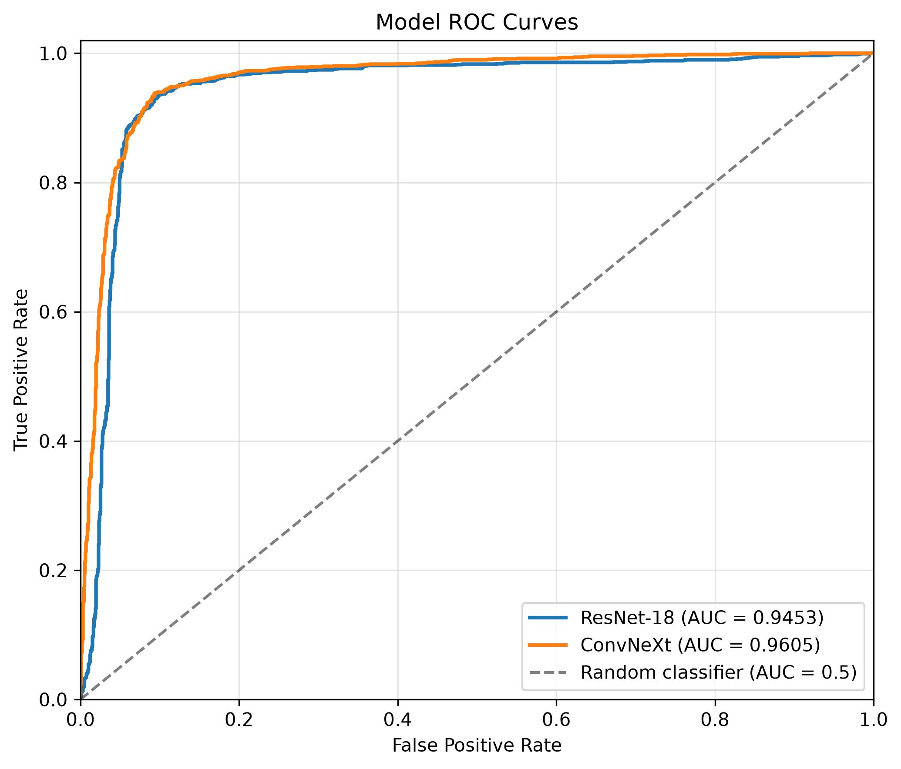
*Plot of ROC curves for both ResNet-18 and ConvNeXt models.*

The ROC curves demonstrate that both ResNet-18 and ConvNeXt achieve strong performance in distinguishing between Alzheimer's disease and normal brain images. However, ConvNeXt achieves a higher ROC-AUC of `96.05%` compared to ResNet-18's `94.53%`, indicating better overall performance across different classification thresholds. ConvNeXt generally achieves a higher sensitivity at lower false positive rates, suggesting that it is more effective at identifying Alzheimer's cases while minimising the number of healthy individuals incorrectly classified as having the disease. This makes it a more promising model for preliminary Alzheimer's screening.

### 7.3 Comparison of Model Computational Efficiency
To measure the difference in inference time and GPU VRAM usage, both models ran inference on the same image from the test set, and only started measuring after the dataset loading and preprocessing was complete.


| Model     | Inference Time | Peak VRAM Usage |
| --------- | -------------- | --------------- |
| ResNet-18 | 0.1659s        | 74.86 MB        |
| ConvNeXt  | 0.2891s        | 154.38 MB       |

*Time for inference and Peak VRAM usage for ResNet-18 and ConvNeXt models.*

From the table it can be seen that both models ran inference on the same test image in less than half a second. ConvNeXt used over twice the amount of VRAM compared to ResNet-18, however this is still easily within the available VRAM of most modern devices. 

This shows that both models can be used in a clinical setting on a modern device, to receive results quickly. ResNet-18 however, is able to run inference faster and with less VRAM.

### 7.4 Justifying Architectural Complexity and Computational Complexity

ConvNeXt only had a `0.39` percentage points improvement in overall test accuracy compared to ResNet-18. This modest gain alone does not justify its added architectural complexity and computational cost. A convincing advantage would require ConvNeXt to accept more cases at the same error rate. The available evidence does not establish that ConvNeXt offers sufficient benefit over the baseline. ResNet-18 therefore remains a reasonable candidate for further evaluation.

### 7.5 Final Result

Although ConvNeXt's small improvement in test accuracy does not, on its own, justify the increased architectural complexity and computational cost compared to ResNet-18, **ConvNeXt is the better performing model for this task** based on its results on the held-out test set. Its higher computational requirements remain manageable on modern hardware. 

Therefore, where modern hardware is available and predictive accuracy is the priority, ConvNeXt remains the preferred model, while ResNet-18 offers a more computationally efficient alternative.

## 8. Proposed Confidence Threshold and Measured Coverage
The key question is whether ConvNeXt offers more reliable confidence on ambiguous examples than the baseline ResNet-18 model. The proposed rule is model's will automatically accept the prediction when its confidence is at least `90%` and refers predictions below `90%` for human review.

| Metric at 90% confidence threshold | ResNet-18 | ConvNeXt |
| --- | ---: | ---: |
| Total test images | 3,060 | 3,060 |
| Automatically accepted images | 2,904 | 2,916 |
| **Coverage** | **94.90%** | **95.29%** |
| Images referred for human review | 156 | 144 |
| **Referral rate** | **5.10%** | **4.71%** |
| Correct accepted predictions | 2,699 | 2,718 |
| Incorrect accepted predictions | 205 | 198 |
| **Accuracy of accepted predictions** | **92.94%** | **93.21%** |
| Error rate among accepted predictions | 7.06% | 6.79% |
| Meets at least 80% coverage | **Yes** | **Yes** |

*Coverage results for ResNet-18 and ConvNeXt models with 90% confidence threshold.*

At a 90% confidence threshold, most images can be automatically classified under the proposed rule. ResNet-18 accepts `94.90%` of test images, leaving `5.10%` for human review, while ConvNeXt accepts `95.29%`, leaving `4.71%` for review. Both therefore exceed the acceptance criteria of automatically classifying at least `80%` of images.

ConvNeXt accepts `12` more images and has an accepted prediction accuracy of `93.21%` compared with `92.94%` for ResNet-18. This shows that ConvNeXt provides **slightly greater coverage and accepted accuracy at this confidence threshold**.

## 9. Failure Case Autopsy & Manager Recommendation
To identify possible failure triggers for incorrect predictions, four misclassified predictions by the ConvNeXt model were selected.

### 9.1 Image `272543_84`: AD predicted as NC

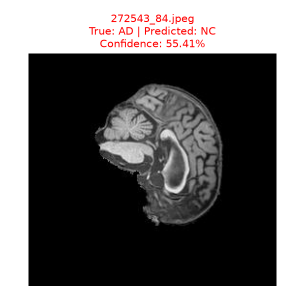

This prediction had a confidence of `55.41%` which is close to the binary decision boundary. This could indicate there is insufficient discriminative information in this slice. Features learned for AD and NC may overlap here, producing an uncertain prediction.

### 9.2 Image `345688_92`: AD predicted as NC
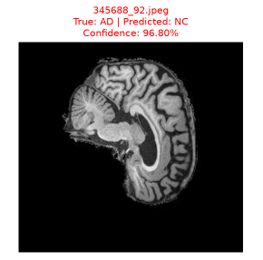

This scan appears relatively clear and does not show obvious signs of degradation. The model predicted this slice as a confident false negative with a confidence of `96.80%`. The model may associate the visible tissue pattern with NC while missing relevant evidence elsewhere in the scan.

### 9.3 Image `1346089_90`: NC predicted as AD
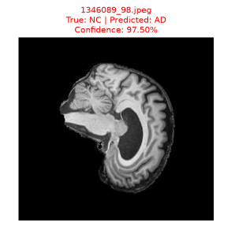

This slice shows a prominent dark internal space and strongly contrasted surrounding tissue. The model confidently predicted this NC scan as AD with `97.50%` confidence. This may indicate the model's overreliance on coarse structural patterns. The model may have learned to associate the apparent size of internal black spaces with AD.

### 9.4 Image `1415454_93.jpeg`: NC predicted as AD
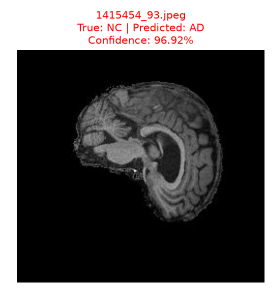

This slice appears relatively darker with less distinct tissue detail. This indicates that brightness or contrast is acting as an unintentional cue for the model to confidently predict NC as AD with `96.92%` confidence. Reduced visibility of fine structures may encourage reliance on global intensity and texture. This may be a result of the scan being an edge slice of the brain resulting in edge slices being confidently predicted as false positives.


### 9.5 Actionable Recommendation
An actionable improvement is to aggregate predictions across all available slices from each patient, rather than classify each image independently. Using majority voting from multiple slices, would allow predictions from multiple slices to contribute to the final patient level prediction, potentially reducing the influence of ambiguous images. Strong disagreement between slices could also be used to flag a patient for human review.

## 10. Project Structure
### 10.1 Repository Structure
```
PatternAnalysis-2026/recognition/
└── ConvNeXt_48900353/
    ├── dataset.py
    ├── modules.py
    ├── train.py
    ├── predict.py
    ├── requirements.txt
    ├── images/
    └── README.md
```

### 10.2 Project Files
| File | Responsibility |
| --- | --- |
| `modules.py` | Implementations for ResNet-18 and ConvNeXt |
| `dataset.py` | File loading, patient id based image splitting, transforms and dataloaders |
| `train.py` | Hyperparameter configuration, training, evaluation and result saving |
| `predict.py` | Trained model loading, running inference using model on test images, saving predictions as image |
| `requirements.txt` | Required dependencies for project |

### 10.3 Reproducibility
The default seed is `42`. It is used by both stratified splits, PyTorch initialisation, CUDA seeding, and the DataLoader generators. Thus using the same ADNI dataset, should produce the exact same image splits and training results across different runs.

## 11. Usage Instructions
### 11.1 Environment Setup
First clone repository and install dependencies:
```bash
git clone https://github.com/marchchris/PatternAnalysis-2026.git
cd PatternAnalysis-2026/recognition/ConvNeXt_48900353
git checkout topic-recognition
pip install -r requirements.txt
```

### 11.2 Training
Run training using with:

```bash
python train.py --dataset-root [DATASET ROOT] --model-name resnet18 --seed [SEED] --epochs [EPOCHS] --batch-size [BATCH SIZE] --learning-rate [LEARNING RATE] --weight-decay [WEIGHT DECAY] --warmup-epochs [NUM WARMUP EPOCHS] --num-workers [NUMB LOADER WORKERS]
```

| Optional argument | Description | Default |
| --- | --- | --- |
| `--dataset-root` | Path to the ADNI dataset root containing `train/` and `test/` | `~/Documents/Datasets/ADNI/AD_NC` |
| `--model-name` | Model architecture to train | `resnet18` or `convnext` |
| `--seed` | Random seed | `42` |
| `--epochs` | Number of training epochs | `200` |
| `--batch-size` | Number of images per batch | `64` |
| `--learning-rate` | Initial learning rate | `0.001` |
| `--weight-decay` | AdamW weight decay | `0.0001` |
| `--warmup-epochs` | Number of linear warmup epochs | `5` |
| `--num-workers` | Number of DataLoader worker processes | `4` |

Each run creates its own `Models/<model-name>/<model-name>_<timestamp>/` directory and stores `<model-name>.pth`, `training_history.png`, `confusion_matrix.png`, and `test_report.txt.` The saved weights correspond to the highest validation accuracy, which may occur before epoch 200.

An example of `test_report.txt` is:
```
Model Training Report:
Training time: 88m 12s

Average time per epoch: 26.46s

Test Set Evaluation Report:
Test loss: 0.3601
Accuracy: 0.9163
Precision (AD positive): 0.8893
Recall (AD positive): 0.9446
F1 Score (AD positive): 0.9161
ROC AUC: 0.9596
Support: 3060
Negative support: 1580
Positive support: 1480
```

### 11.3 Running Predictions

Run predictions using a saved model checkpoint with:

```bash
python predict.py --model convnext --weights Models/convnext/convnext_[TIMESTAMP]/convnext.pth
```

By default, the script selects `9` images from the test split, prints the
prediction details for each image, and saves a prediction visualisation to
`Inferences/predictions_[TIMESTAMP].png`. A different number of test images can
be selected with:

```bash
python predict.py --model resnet18 --weights Models/resnet18/resnet18_[TIMESTAMP]/resnet18.pth --num-images 12
```

An individual image can be supplied instead of sampling from the test split:

```bash
python predict.py --model convnext --weights Models/convnext/convnext_[TIMESTAMP]/convnext.pth --image path/to/image.jpeg
```

| Optional argument | Description | Default |
| --- | --- | --- |
| `--image` | Path to one image to predict instead of sampling test images | Test split |
| `--num-images` | Number of test images to sample when `--image` is not supplied | `9` |
| `--dataset-root` | Path to the ADNI dataset root | `~/Documents/Datasets/ADNI/AD_NC` |
| `--output` | Output path for the prediction visualisation | `Inferences/predictions.png` |

The required arguments are:

| Required argument | Description |
| --- | --- |
| `--model` | Model architecture used by the checkpoint: `resnet18` or `convnext` |
| `--weights` | Path to the saved `.pth` model checkpoint |

For every prediction, the script prints the predicted class, confidence,
class probabilities, prediction time, and peak VRAM usage. Prediction timing
and VRAM usage are measured during model evaluation after the image has been
loaded and preprocessed.

An example of the prediction visualisation saved from the trained ConvNeXt model:

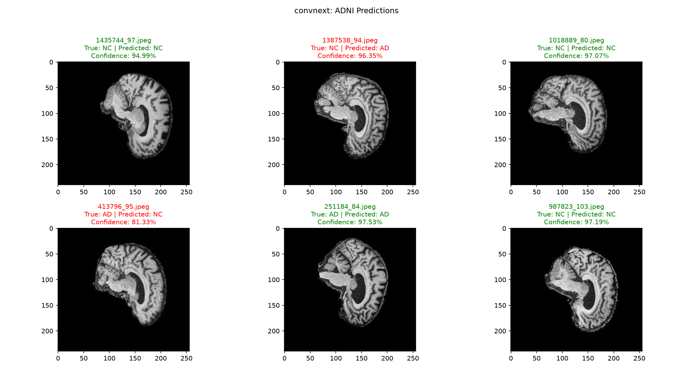
*Example of saved visualisation of predictions from `predict.py`.*


## References
- 1. Liu, Z., Mao, H., Wu, C.-Y., Feichtenhofer, C., Darrell, T., Xie, S., Facebook, A., & Research. (2022). A ConvNet for the 2020s. https://arxiv.org/pdf/2201.03545
- 2. He, K., Zhang, X., Ren, S., & Sun, J. (2015, December 10). Deep residual learning for image recognition. arXiv. arXiv.Org. https://arxiv.org/abs/1512.03385
- 3. ADNI. (2024). Alzheimer’s disease neuroimaging initiative. ADNI. https://adni.loni.usc.edu/data-samples/adni-data/


## Artificial Intelligence Usage Disclosure
- ChatGPT 6 was used for assisting with markdown syntax, table creation, spell check, and refinement of wording in the README, all actual content and information was written by myself.
- GitHub Copilot (ChatGPT 5.6) was used to assist in writing code documentation and comments, and minor code refactoring. All data loading, preprocessing, training and analysis code was written by myself.
